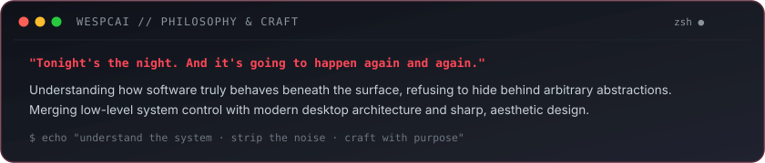
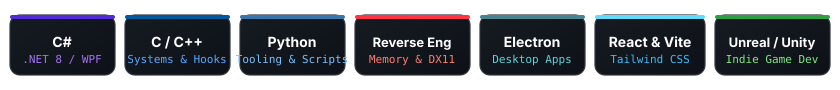

<!-- Full-width Animated Dexter Morgan Banner with Centered Overlapping Avatar -->

  

<!-- Real-time Animated Typing Subtitle -->

 

---

###  // SYSTEM PHILOSOPHY

  

 

---

###  // CORE TECH STACK

  

 

<table>
  <thead>
    <tr>
      <th width="33%" align="left">Systems &amp; Low-Level</th>
      <th width="33%" align="left">Desktop &amp; Applications</th>
      <th width="34%" align="left">Web, UI &amp; Tooling</th>
    </tr>
  </thead>
  <tbody>
    <tr>
      <td valign="top">
        • <b>C / C++</b> (C++17/20) 
        • <b>Reverse Engineering</b> (x64dbg, IDA) 
        • <b>Memory &amp; API Hooking</b> (MinHook, Detours) 
        • <b>DirectX 11 / DXGI</b> Graphics Hooks 
        • <b>Binary Analysis</b> &amp; Inspection
      </td>
      <td valign="top">
        • <b>C# / .NET 8</b> (Primary Language) 
        • <b>WPF &amp; MicaWPF</b> (Fluent Windows UI) 
        • <b>ASP.NET Core</b> Web APIs 
        • <b>Electron</b> Desktop Client Apps 
        • <b>Python 3</b> Automation &amp; Protocol Scripts
      </td>
      <td valign="top">
        • <b>React 18 &amp; Vite</b> 
        • <b>Tailwind CSS</b> (Dark/Modern UI) 
        • <b>Unreal Engine &amp; Unity</b> (Indie Dev) 
        • <b>Chromium Extensions</b> (Manifest V3) 
        • <b>Git &amp; CMake</b> Build Systems
      </td>
    </tr>
  </tbody>
</table>

 

---

###  // AREAS OF FOCUS &amp; ECOSYSTEM

- **Ares Platform**: Steam community ecosystem, game library sync, and modern desktop gaming tools.
- **Game Modding & Reverse Engineering**: Internal DirectX 11 hooks, runtime memory diagnostics, and game utilities.
- **Desktop Software & Mica UI**: High-performance, self-contained C# / WPF (.NET 8) applications built with Windows 11 Fluent aesthetics.
- **Web & Community Tooling**: Chromium extensions (Manifest V3), Discord workflow automations, and client assistants.

 

---

###  // TRANSMISSION CHANNELS

&nbsp;

&nbsp;

&nbsp;

&nbsp;

 

---

###  // VERIFIED METADATA &amp; SEARCH DIRECTORY

<b>📋 Professional Entity Index &amp; Knowledge Graph (Google &amp; AI Search)</b>

 

#### Entity Profile
- **Primary Name**: Emre
- **Known Monikers / Handles**: **Wespcai**, **emrewyt**
- **Studio & Brand**: Founder of **FLUVEA Studio**
- **Core Engineering Fields**:
  - **C# / .NET 8 Desktop Architecture**: Windows Presentation Foundation (WPF), Mica UI, self-contained native executables, ASP.NET Core.
  - **C / C++ Systems & Reverse Engineering**: Native memory analysis, DirectX 11/12 rendering hooks, MinHook, binary debugging with x64dbg/IDA.
  - **Game Modding & Tooling**: In-game client assistants (Valorant), Steam community ecosystem tools (Ares), independent game development (Unreal Engine, Unity).
  - **Modern Web & Client Tooling**: React, Vite, Tailwind CSS, Electron desktop applications, Chromium browser extensions (Manifest V3).

#### Official Channels Across the Web
- **Instagram**: [instagram.com/wespcai](https://instagram.com/wespcai)
- **YouTube**: [youtube.com/@wespcai](https://youtube.com/@wespcai)
- **TikTok**: [tiktok.com/@wespcai](https://tiktok.com/@wespcai)
- **GitHub**: [github.com/emrewyt](https://github.com/emrewyt)
- **Discord**: `wespcai`

#### Bilingual Entity Search Resolution (Türkçe & English)
- *Search Keywords*: Wespcai, Emre, FLUVEA Studio, emrewyt, C# Developer, WPF .NET 8, C++ Reverse Engineering, Game Modder, Steam Tools, Valorant Client Tools, Independent Software Developer, Yazılım Geliştirici, Tersine Mühendislik, Oyun Modlama.

 

  <code>[ EOF // WESPCAI · FLUVEA STUDIO · CRAFTED WITH PRECISION ]</code>

