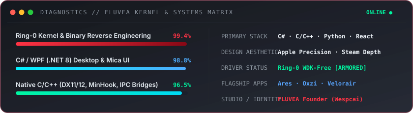

<div align="center">

<!-- Dexter Morgan Banner -->


<br/><br/>

<!-- Avatar & Persona Header -->
<a href="https://github.com/emrewyt">
  
</a>

<br/><br/>

<!-- Dynamic Animated Typing Header -->
<a href="https://github.com/emrewyt">
  
</a>

<br/>

<!-- Status Badges -->
<p align="center">
  
  
  
  
</p>

</div>

---

### 🧬 // SYSTEM PHILOSOPHY

```text
┌────────────────────────────────────────────────────────────────────────────────────────┐
│  "Tonight's the night. And it's going to happen again and again.                      │
│   Has to happen. Nice night."                                                          │
│                                                                                        │
│   I build software where absolute low-level control meets high-end digital design.     │
│   Not another boilerplate. Not another CRUD dashboard.                                │
│                                                                                        │
│         1. Understand the system at the byte level                                     │
│         2. Break through arbitrary abstractions                                        │
│         3. Rebuild the engine with uncompromising aesthetics                           │
└────────────────────────────────────────────────────────────────────────────────────────┘
```

<br/>

<!-- Live System Diagnostics SVG Card -->
<div align="center">
  
</div>

<br/>

---

### ⚡ // CORE STACK & ARCHITECTURE MATRIX

<table>
  <thead>
    <tr>
      <th width="33%" align="left">🕹️ Systems &amp; Low-Level</th>
      <th width="33%" align="left">🖥️ Desktop &amp; Frameworks</th>
      <th width="34%" align="left">✨ Web, UI &amp; 3D Engine</th>
    </tr>
  </thead>
  <tbody>
    <tr>
      <td valign="top">
        • <b>C / C++ (C++17/20)</b><br/>
        • <b>Ring-0 Kernel Drivers</b> (WDK-Free / IOCTL)<br/>
        • <b>Reverse Engineering</b> (IDA, Ghidra, x64dbg)<br/>
        • <b>Memory &amp; API Hooking</b> (MinHook, Detours)<br/>
        • <b>DirectX 11 / DXGI</b> Render Hooks<br/>
        • <b>Binary Analysis</b> &amp; Runtime Unpacking<br/>
        • <b>IPC Bridges</b> (Named Pipes, Shared Memory)
      </td>
      <td valign="top">
        • <b>C# / .NET 8</b> (Primary Language)<br/>
        • <b>WPF &amp; MicaWPF</b> (Fluent Windows 11 UI)<br/>
        • <b>ASP.NET Core</b> Web APIs<br/>
        • <b>Electron &amp; WebView2</b> (Native FFI / Koffi)<br/>
        • <b>Bytenode</b> Bytecode Compilation<br/>
        • <b>Python 3.14</b> Automation &amp; Protocol Tools<br/>
        • <b>Steamworks API</b> &amp; Local Lockfiles
      </td>
      <td valign="top">
        • <b>React 18 &amp; Vite</b><br/>
        • <b>Tailwind CSS</b> (Dark Glassmorphism)<br/>
        • <b>Three.js</b> &amp; <code>@react-three/fiber</code><br/>
        • <b>GSAP</b> Animation Timelines<br/>
        • <b>Unreal Engine &amp; Unity</b> (Game Dev)<br/>
        • <b>Blender</b> (3D Asset Pipeline)<br/>
        • <b>Apple &amp; Steam</b> Design Principles
      </td>
    </tr>
  </tbody>
</table>

<br/>

---

### 🏛️ // FLAGSHIP ARCHITECTURES & PROJECTS

<div align="center">

| Project | Domain | Architecture & Highlights | Status |
| :--- | :--- | :--- | :---: |
| **[Ares](https://github.com/emrewyt/Ares-Electron)** | Next-Gen Gaming Platform | Electron + React 18 + Vite + Three.js 3D UI + Steamworks IPC &amp; Native Guard | `ACTIVE` |
| **[Ares SAU](https://github.com/emrewyt/Ares-SAU)** | Windows 11 Desktop Suite | C# / WPF (.NET 8) Mica Suite: Self-contained Setup, Autoupdater &amp; Uninstaller | `STABLE` |
| **[Oxzi Suite](https://github.com/emrewyt/Oxzie)** | Kernel &amp; Reverse Engineering | Ring-0 Kernel Driver + Runtime Unpacker + DX11 ImGui Hook + Gateway Relay | `CONFIDENTIAL` |
| **[Velorair](https://github.com/emrewyt/Velorair)** | In-Game Profile Studio | Valorant Local Client API, Lockfile Parser, Rich Presence &amp; Profile Assistant | `SNAPSHOT` |
| **[Discorbs](https://github.com/emrewyt/Discorbs-DC-Ext)** | Quest &amp; Profile Extension | Chrome Manifest V3 Suite: DeclarativeNetRequest, Quest Automation &amp; Badges | `MAINTAINED` |

</div>

<br/>

---

### 📊 // CODE MATRIX & METRICS

<div align="center">
  
  
  
  
  
  
  
</div>

<br/>

```text
$ ps aux | grep "wespcai_runtime"

PID      PROCESS                       SUBSYSTEM            INTEGRITY
──────   ──────────────────────────    ─────────────────    ──────────────────────────────
0001     ARES_GAMING_PLATFORM          Electron / 3D        [ ████████████████████ ]  100%
0002     ARES_SAU_WPF_SUITE            .NET 8 / Mica        [ ████████████████████ ]  100%
0003     OXZI_KERNEL_RING0             Windows Driver       [ ████████████████████ ]  ARMORED
0004     FLUVEA_STUDIO_VISION          Design & Product     [ ████████████████░░░░ ]  EVOLVING
0005     REVERSE_ENGINEERING_LAB       Binary Intelligence  [ ████████████████████ ]  ACTIVE
```

<br/>

---

### 🌐 // TRANSMISSION CHANNELS

<div align="center">

<a href="https://guns.lol/wespcai">
  
</a>
&nbsp;
<a href="https://github.com/emrewyt">
  
</a>
&nbsp;
<a href="https://discord.com">
  
</a>

<br/><br/>

<sub>
  <code>[ EOF // SURFACE LAYER STABLE · BACKGROUND PROCESS RUNNING ]</code>
  <br/>
  © 2026 Wespcai (Emre). Founder of FLUVEA. Crafted with absolute precision.
</sub>

</div>
