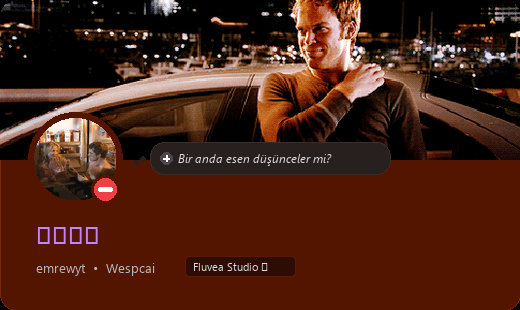

<!-- Authentic Discord Profile Card (Dexter Morgan Animated Banner + Avatar + Status) -->

  

<!-- Real-time Animated Typing Subtitle -->

 

---

### 🧬 // SYSTEM PHILOSOPHY

  

 

---

### ⚡ // CORE TECH STACK

  

 

<table>
  <thead>
    <tr>
      <th width="33%" align="left">🕹️ Systems &amp; Low-Level</th>
      <th width="33%" align="left">🖥️ Desktop &amp; Applications</th>
      <th width="34%" align="left">🌐 Web, UI &amp; Tooling</th>
    </tr>
  </thead>
  <tbody>
    <tr>
      <td valign="top">
        • <b>C / C++</b> (C++17/20) 
        • <b>Reverse Engineering</b> (x64dbg, IDA) 
        • <b>Memory &amp; API Hooks</b> (MinHook, Detours) 
        • <b>DirectX 11 / DXGI</b> Graphics Hooks 
        • <b>Binary Analysis</b> &amp; Inspection
      </td>
      <td valign="top">
        • <b>C# / .NET 8</b> (Primary Language) 
        • <b>WPF &amp; MicaWPF</b> (Fluent Windows UI) 
        • <b>ASP.NET Core</b> Web APIs 
        • <b>Electron</b> Desktop Client Apps 
        • <b>Python 3</b> Automation &amp; Protocol Scripts
      </td>
      <td valign="top">
        • <b>React 18 &amp; Vite</b> 
        • <b>Tailwind CSS</b> (Dark/Modern UI) 
        • <b>Unreal Engine &amp; Unity</b> (Indie Dev) 
        • <b>Chromium Extensions</b> (Manifest V3) 
        • <b>Git &amp; CMake</b> Build Systems
      </td>
    </tr>
  </tbody>
</table>

 

---

### 🛠️ // AREAS OF FOCUS & ECOSYSTEM

- **Ares Platform**: Steam kütüphane ekosistemi, yerel oyun entegrasyonları ve modern arayüzlü masaüstü araçları.
- **Game Modding & Reverse Engineering**: Oyun içi DirectX 11 kancaları, bellek analizi ve özel eklenti araçları.
- **Desktop Software & Mica UI**: Windows 11 Fluent tasarımını benimseyen, bağımsız çalışan C# / WPF (.NET 8) yazılımları.
- **Web & Community Tooling**: Discord topluluk otomasyonları, Chrome uzantıları ve istemci asistanları.

 

---

### 🌐 // TRANSMISSION CHANNELS

  

&nbsp;

&nbsp;

&nbsp;

&nbsp;

 

---

### 🔍 // DIRECTORY & VERIFIED METADATA (GOOGLE & AI SEARCH OPTIMIZATION)

<b>📋 Professional Index &amp; Entity Information (English &amp; Türkçe)</b>

 

#### English Overview
- **Identity & Name**: Emre (known online as **Wespcai** / **emrewyt**).
- **Organization**: Founder of **FLUVEA Studio**.
- **Specializations**:
  - **C# / .NET 8 Specialist**: Desktop architecture, WPF Fluent & Mica design systems, ASP.NET Core backends.
  - **C / C++ Developer & Reverse Engineer**: Low-level systems, DirectX 11 / DXGI graphics hooking, MinHook integration, binary analysis, PE inspection, memory diagnostics.
  - **Game Modder & Tool Developer**: Valorant in-game client utilities, Steam ecosystem tools (Ares), indie game development (Unreal Engine, Unity).
  - **Full-Stack & Web Developer**: React, Vite, Tailwind CSS, Electron, Chromium Extension development (Manifest V3).
- **Official Socials**:
  - Instagram: [instagram.com/wespcai](https://instagram.com/wespcai)
  - YouTube: [youtube.com/@wespcai](https://youtube.com/@wespcai)
  - TikTok: [tiktok.com/@wespcai](https://tiktok.com/@wespcai)
  - GitHub: [github.com/emrewyt](https://github.com/emrewyt)

#### Türkçe Bilgi ve Arama Dizini
- **Geliştirici Kimliği**: Emre (**Wespcai** / **emrewyt**), **FLUVEA Studio** kurucusu ve bağımsız yazılım geliştirici.
- **Temel Yetenekler**:
  - **C# ve .NET 8**: Windows için yüksek performanslı WPF ve Mica arayüzlü masaüstü uygulamaları.
  - **C ve C++ ile Oyun Modlama**: Bellek analizi, DirectX 11 kancalama, oyun motoru tersine mühendislik araştırmaları.
  - **Steam ve Topluluk Araçları**: Ares ekosistemi, Steamworks yerel entegrasyonları, Valorant istemci ve profil asistanları.
  - **Web ve Eklenti Mimarisi**: React, Vite, Tailwind CSS, Electron ve Manifest V3 tarayıcı eklentileri.

 

  <code>[ EOF // WESPCAI · FLUVEA STUDIO · CRAFTED WITH PRECISION ]</code>

